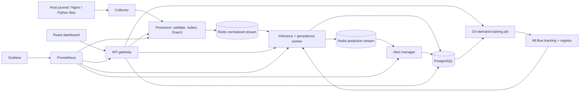

# Architecture and engineering decisions

Status: Phases 1–6 foundation, ingestion, training, inference, durable streams and alerts implemented. Ingestion adapter
execution remains pending. Actual ML training ran on Python 3.14; deployment runtime and
subsequent services still require validation.

## Ownership and service boundaries

| Component | Responsibility | Planned internal port |
|---|---|---|
| Collector | File cursors, user journal cursor, simulation, bounded publish retries | none (worker heartbeat) |
| Processor | Parsing, Pydantic validation, redaction, templates, stream publishing | 8012 |
| Inference | Approved version loading, HTTP prediction, normalized-stream consumer | 8013 |
| Alert manager | Prediction consumer, grouping, alert state machine and history | 8014 |
| API gateway | Versioned REST, filters, aggregation, admin authorization, training dispatch | 8000 |
| Training | Separate one-shot process; immutable data snapshot and model evaluation | none |
| Frontend | Eight dashboard pages consuming gateway REST | 5173 dev / 8080 container |
| PostgreSQL / Redis | Durable records / bounded streams and recovery | 5432 / 6379 |
| MLflow / Prometheus / Grafana | Experiments and registry / metrics / dashboards | 5000 / 9090 / 3000 |

Each service will have its own entry point, dependencies, environment configuration,
Dockerfile and health checks. Shared modules contain contracts and infrastructure helpers,
not a central application. Gateway routes use `/api/v1/`. Only browser-facing ports bind
127.0.0.1; database, Redis and worker ports remain internal. Application containers run as
non-root. Infrastructure images retain their vendor initialization behavior.

## Delivery and persistence

Redis consumer groups provide at-least-once delivery. Consumers acknowledge only after a
successful database transaction. Unique event IDs and prediction keys (event ID, model
version) make retries idempotent. Pending entries are reclaimed after a configurable idle
time; bounded retries lead to a redacted dead-letter stream. A transactional outbox will
bridge prediction persistence and alert publication, avoiding a database/Redis dual-write
loss window. Stream trimming must account for consumer lag; durable PostgreSQL history is
the replay source. Explicit backpressure and queue metrics bound memory consumption.

`log_events` owns ingestion identity and provenance; `normalized_logs` owns the single
redacted message, template and normalized fields. `predictions` references normalized logs
and model versions. `alerts` references representative events and keeps occurrence counts;
alert history and audit events record transitions. `training_runs`, `model_versions`,
`data_sources` and an outbox complete the schema. Alembic owns all schema changes. A retention
job deletes expired logs in bounded batches, respecting alert references and audit retention.
Raw sensitive messages are never stored or displayed: “original message” means its redacted
representation. Invalid events expose reason codes, not payloads.

## ML consistency and evaluation

One serialized feature pipeline contains the fitted TF-IDF vectorizer, categorical encoder,
numerical transforms and Isolation Forest. A numerical/frequency baseline is evaluated on
the same temporal holdout. Frequency and error-rate features use only prior events within
bounded windows; training replay and online inference share the implementation and warm-up
policy. Labels and future events never enter features. ERROR is a feature, never a label.

Scores are uncalibrated anomaly scores with a documented direction and threshold. Labeled
holdouts yield precision, recall, F1, confusion matrix and false positive rate; unlabeled
runs report score distributions, latency and drift only. Persist seeds, dataset checksums,
feature versions, dependencies and split boundaries. Approval gates and audit records control
promotion to an MLflow alias. Inference loads an explicit approved version atomically and
reports it per prediction; failed loads keep readiness false or preserve the last healthy
version. Training executes outside HTTP request handling with bounded concurrency and a
persisted job state; triggering and promotion require an admin token.

## Security and observability

Redact tokens, credentials, email addresses and sensitive identifiers before persistence or
metrics. Exclude authentication journal units by default; the host collector uses current-user
journal permissions. Do not mount the Docker socket or grant privileged containers. Additional
journal access is a deliberate host permission choice, never a root application requirement.

Health indicates process liveness; readiness checks required dependencies and model state.
Prometheus tracks request rates, errors, histograms, queue lag, retries, dead letters and
model version info with bounded label cardinality. Never use event IDs/messages as labels.
Drift compares feature/score distributions to a saved reference; it does not imply predictive
accuracy without ground truth. Local admin tokens, CORS allowlists, rate limits, request
limits, timeouts and audit trails protect mutating operations.

## Resource target and compatibility

Initial full-stack target: 4 CPU cores, 8 GB RAM, 10 GB free disk; this is a planning estimate,
not a measured requirement. Training is opt-in. Python 3.12 is the reproducible backend
runtime; Node 26 LTS is the frontend runtime. PostgreSQL 17 and Redis 7.4 are the initial
infrastructure lines. Exact application dependency locks and tested image digests will be
added with each implementation phase; the repository does not yet claim a validated stack.

## Phase 2 concrete contracts

`shared/schemas/logs.py` defines immutable domain records; the processor's Pydantic envelope
adds strict HTTP validation. `shared/common/redaction.py` runs after parsing and before
template mining or publishing. `log_processor` owns parsing/normalization and
`log_collector` owns byte/journal cursors and delivery retries. Collectors send directly to
the processor; the unused raw-stream setting is reserved for future ingestion buffering.
No raw log stream or raw disk spool is currently written.

The collector is a worker with a durable readiness heartbeat, rather than an HTTP service.
The processor publishes to Redis by default. The explicit local development path uses the
same normalization with SQLite and masked templates. Neither substitutes for PostgreSQL
or Drain3 in the default service architecture. Redis consumer groups, database outbox and
consumer-aware trimming remain Phase 6. See [ingestion](ingestion.md) for rotation, template
state and deduplication-window limits.

## Phase 3 concrete ML contracts

`ml/features` owns the versioned, bounded causal extractor. `ml/model.py` owns fitted bundle
scoring and ordered sessions shared by future inference. The `ml_training` service owns
import/provenance validation, temporal splitting, train-only pipeline fitting, comparison
and checksummed artifacts. `compose.training.yml` defines a non-root on-demand job profile.
Models save no mutable stream window state. Batch holdout replay warms from preceding
training observations; cold online startup and late-event policies are explicit contracts.
All candidates remain unapproved until Phase 4 evaluation/registry gates. See
[training](training.md) for feature definitions and the executed validation record.

## Phase 4 evaluation and registry boundaries

`evaluation.py` owns explicit label contracts, metrics and quality policy. `lifecycle.py`
separates future calibration from later test scoring and seals lineage/selection before
evaluation. `tracking.py` logs actual MLflow experiments. `registry.py` enforces admin
authorization, quality/scope gates, curated model packaging and verified explicit aliases.
`audit.py` records durable local intent/outcome events and serializes writers; PostgreSQL
audit integration remains Phase 7. Model registration is independent of alias promotion.
Synthetic evidence never permits production champion promotion.

MLflow uses a persistent local SQLite backend in the optional development profile; its UI
is localhost-only. The application data plane still targets PostgreSQL. Both the host CLI
and opt-in lifecycle container can record runs. The default candidate failed its independent
synthetic test gates and remains unapproved. See [lifecycle](model-lifecycle.md).

## Phase 5 inference boundary

`ml_inference.loader` verifies registration/audit/package/runtime evidence before loading
the trusted bundle; it imports no training business code. Shared package hashing lives in
`shared/common/model_integrity.py`, used by registration and inference. Shared HTTP
contracts live in `shared/schemas/predictions.py`. `ml_inference.engine` owns transactional
causal contexts, duplicate response caches and atomic approved-version swaps. The FastAPI
module only handles validation/auth/limits and delegates model work to that engine.

Normal HTTP prediction and diagnostic CLI scoring share the same engine. Production rejects
development-scoped models and threshold overrides. Context state is bounded, process-local
and single-worker; durable stream processing remains Phase 6. The optional inference
Compose file mounts the lifecycle ledger read-only and exposes only localhost. The persisted
model remains unapproved, so default readiness is false. See [inference](inference.md).

## Phase 6 transactional stream boundary

`shared/pipeline` owns stream contracts, Redis group/publisher adapters, SQLAlchemy tables,
connection policy, durable receipts/checkpoints and outbox orchestration. The initial frozen
Alembic revision is in `infrastructure/postgres/migrations`; schema creation is explicit.
`ml_inference.stream_worker` owns inference-specific handling/context restoration.
`alert_manager` owns anomaly eligibility, recurring groups, status actions and history; its
API and consumer are separate processes. No training logic runs in online workers.

Prediction/checkpoint/outbox writes precede source ACK. Outbox publication and alert receipts
handle replay across the SQL/Redis boundary without a globally exactly-once claim. A single
active ordered handler per group protects causal state, with SQL revision checks/uniqueness
for stale/concurrent work. Late event-time input is quarantined, not silently approximated.
The default deployment uses PostgreSQL; SQLite/memory-broker tests do not prove live Redis
or PostgreSQL behavior. See [stream/alert operations](streams-and-alerts.md).
