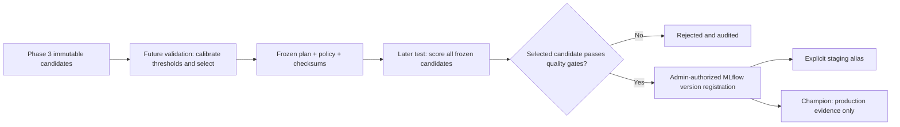

# Phase 4: evaluation, MLflow and model approval

## Lifecycle and data separation



The original Phase 3 holdout was already inspected. It is not reused as an independent
Phase 4 test. Calibration data must follow the entire original history (training plus that
holdout). Final test data must follow calibration data. IDs cannot overlap. Training history
must match the candidate report's dataset hash and final timestamp. Calibration plans bind
the training manifest, candidate checksums, data hashes, policy and selected candidate.

Calibration uses validation labels only. A grouped score sweep chooses a threshold maximizing
validation F1 under the policy's false positive limit; tied scores cannot be split. All
candidate thresholds and selection are written to a sealed plan before final test scoring.
The test evaluates every frozen candidate on the same event IDs, but cannot change the
selected candidate. Unlabeled validation retains original thresholds and requires an explicit
candidate choice. Policies must be chosen before evaluating the test; never lower them to
retroactively approve a failed model. New exploratory choices require new, untouched test
traffic before making an independent performance claim.

These controls prevent accidental reuse and automatic test-based selection. They cannot
prove that an operator has never inspected external labels or edited trusted artifacts.
Keep dataset lineage and reviews alongside the generated hashes.

## Install and track training

Activate a Python environment, then:

```bash
python -m pip install -r services/ml-training/requirements-mlflow.txt
python -m pip check
export PYTHONPATH="$PWD:$PWD/services/ml-training"
export MLFLOW_DISABLE_AGENT_HINT=1
export MLFLOW_ENABLE_TELEMETRY=false
export MLFLOW_TRACKING_URI="sqlite:///$PWD/.local/mlflow/tracking.db"
export MLFLOW_ARTIFACT_ROOT="$PWD/.local/mlflow/artifacts"
mkdir -p .local/mlflow
# Use the actual Phase 3 directory printed by training:
RUN_DIR='ml/artifacts/<training-run-id>'
python -m ml_training track --run-dir "$RUN_DIR"
```

Replace angle-bracket placeholders before running a command. `RUN_DIR` must contain
`report.json` and `manifest.json`. To train and track in one step, pass `--tracking-uri` to
`train`, or export `MLFLOW_TRACKING_URI` first. Without that flag/environment setting,
Phase 3's local-only training behavior is preserved.

MLflow records a parent training run and one child run per candidate. Parameters include
algorithm, seed, features, hyperparameters, dependency versions, dataset version and training
time. Metrics are the actually measured duration/latency and score diagnostics. Artifacts
include fitted bundles, reports and holdout predictions. Repeating a successfully tracked
training manifest reuses its existing run. Evaluation tracking is likewise idempotent by
its immutable report hash. Failed uploads mark the run FAILED; there is no silent fallback.
If tracking fails after evaluation files were saved, retry with `track --run-dir <evaluation-dir>`.

The optional requirements file pins the resolved MLflow runtime used in this workspace,
including the Phase 3 numerical stack. Processor FastAPI/Pydantic/Uvicorn pins are
aligned with this resolved stack to avoid conflicting development requirements. Model/MLflow execution was verified on Python 3.14.10
using cached wheels, not network downloads. Python 3.12 dependency execution, platform hashes
and container image builds remain unverified.

## Create independent synthetic evaluation traffic

```bash
python -m ml_training make-evaluation \
  --history-dataset ml/datasets/synthetic-phase3.jsonl \
  --output ml/datasets/phase4-v1 --count-per-split 300 --seed 84
```

The directory is created exclusively; existing files are not overwritten. Outputs are
`validation.jsonl`, `validation.labels.jsonl`, `test.jsonl` and `test.labels.jsonl`.
All are explicitly synthetic. The two splits use separate seeds, identities and future
chronological ranges. Expected ERROR retries remain annotated normal; controlled corruption
scenarios are annotated anomalous. This is not LogHub data or production evidence.

Labels are separate JSONL records with exactly these fields:

```json
{"event_id":"a99cb4d8-cbcb-4ee2-a500-e7a259819242","is_anomaly":true,"annotation_origin":"human_review"}
```

Coverage must match the relevant data split exactly, with no duplicate IDs. Booleans must
be JSON booleans, not numbers/strings. Nonsynthetic labels must declare `human_review` or
`benchmark_ground_truth`; synthetic labels declare the controlled scenario/fixture origin.
Label origin is an operator assertion, not automated verification. Model-generated labels
are not accepted as independent ground truth. Real/public datasets use the provenance
manifests described in [training](training.md); no dataset was downloaded in this phase.

## Freeze calibration and evaluate

```bash
python -m ml_training calibrate --run-dir "$RUN_DIR" \
  --history-dataset ml/datasets/synthetic-phase3.jsonl \
  --validation-dataset ml/datasets/phase4-v1/validation.jsonl \
  --validation-labels ml/datasets/phase4-v1/validation.labels.jsonl \
  --policy docs/gate-policy.development.json --output ml/artifacts
# Set the actual returned directory:
PLAN_DIR='ml/artifacts/<calibration-directory>'
python -m ml_training evaluate --run-dir "$RUN_DIR" --plan-dir "$PLAN_DIR" \
  --history-dataset ml/datasets/synthetic-phase3.jsonl \
  --validation-dataset ml/datasets/phase4-v1/validation.jsonl \
  --test-dataset ml/datasets/phase4-v1/test.jsonl \
  --test-labels ml/datasets/phase4-v1/test.labels.jsonl --output ml/artifacts
```

`evaluate` logs its report to MLflow by default. Use `--no-tracking` explicitly for local-only
evaluation. `--history-provenance`, `--validation-provenance` and `--test-provenance` select
separate provenance manifests for nonsynthetic data. Omit `--test-labels` for unlabeled
score/latency diagnostics: supervised metrics become null and approval fails closed.

Feature replay warms from the preceding history. The test's context can include prior
validation observations, never their labels or future test events. No preprocessing or
estimator is fitted again. Original candidates are unchanged; `selected.joblib` is a new
bundle carrying the frozen calibrated threshold. Evaluation artifacts include the report,
per-candidate predictions and checksums, without copying log messages or label sidecars.

The score remains `-score_samples`, higher meaning more unusual. Threshold equality is
normal. Scores are not probabilities. Test metrics include precision, recall, F1, confusion
matrix and false positive rate. Matrix rows are actual classes, columns are predicted
classes, in `[normal, anomaly]` order. Undefined divisions are JSON null, not fabricated
zeros or accuracy claims. Positive/negative support is recorded. The latency is measured
batch feature extraction plus model scoring per event; warm-up, transport and database
costs are excluded. It is not a production single-event latency guarantee.

## Approval policy and access control

The default [development policy](gate-policy.development.json) requires:

| Gate | Default |
|---|---:|
| Test records / positives / negatives | 80 / 5 / 50 |
| Precision / recall / F1 minimum | 0.70 / 0.70 / 0.70 |
| False positive rate maximum | 0.05 |
| Batch feature-and-score milliseconds/event maximum | 100 |

Undefined metrics, missing labels, insufficient support or failed limits block registration.
`scope: production` additionally forbids synthetic training, validation or test data.
Synthetic evidence may qualify a development model only. This is independent from aliases:
a development-scoped version cannot become `champion`, even if someone changes its MLflow
tags. The durable audit ledger is also checked.

Registration/promotion require `ADMIN_API_TOKEN` of at least 24 characters and a matching
token on stdin. The token is never placed in argv or written to audit records. Set the token
from your local secret configuration; for a fresh local environment generate one with
`openssl rand -hex 24`. Python does not automatically load `.env`.

```bash
# Set the returned evaluation directory:
EVAL_DIR='ml/artifacts/<evaluation-directory>'
# These actions succeed only if the frozen evaluation actually passed:
printf '%s\n' "$ADMIN_API_TOKEN" | python -m ml_training register \
  --evaluation-dir "$EVAL_DIR" --actor local-operator --token-stdin
# Set the registered numeric version returned above:
VERSION='<registered-version>'
printf '%s\n' "$ADMIN_API_TOKEN" | python -m ml_training promote \
  --model-name logsentinel-model --version "$VERSION" --alias staging \
  --actor local-operator --reason 'Reviewed independent development evaluation' --token-stdin
python -m ml_training audit
```

Registration creates an actual MLflow pyfunc model and numeric model version with validation,
scope and evidence tags. It does not assign an alias. Retrying an approved evaluation reuses
its audited version. Explicit promotion records the previous alias version and reason.
Registry model packages are hashed, downloaded without deserialization, and verified again
before promotion. A modified package is rejected.

The pyfunc model accepts already-extracted feature rows, not raw logs. Its signature requires
string text/categories and double numeric columns; it returns score and anomaly flag using
the frozen threshold. Ordered stream-window management and registry-version binding belong
to Phase 5 inference. `code_paths` copies only approved Python source packages, never
`ml/datasets`, `ml/artifacts`, `.env` or raw log directories. Trusted Joblib/Python model
artifacts are executable serialization; hashes detect corruption, not authenticity.

The local ledger records intent before external registry mutation and success/failure after
it. It persists across CLI restarts and serializes writers sharing the same audit file.
If MLflow succeeds and the process dies before audit completion, retries stop with a
reconciliation requirement rather than promoting an unaudited version. An operator must
inspect pending/failed audit entries and remote versions; automated reconciliation is not
implemented. Keep this ledger with the registry. It will be integrated with PostgreSQL
`audit_events` in Phase 7.

MLflow itself is a trusted localhost development service. Direct MLflow UI/SDK writes do
not pass through this application's token check; do not expose it publicly. The application
controller's audit/evidence checks protect its own promotion path, not arbitrary host
administrators or another writer using a different ledger. Shared-host/remote RBAC and
transactional cross-service coordination remain future work. HTTP client timeouts/retries
are bounded; remote tracking hosts require explicit `MLFLOW_ALLOW_REMOTE=true`.

## View MLflow locally

For the direct SQLite store above, run on a normal host with socket access:

```bash
mlflow server --host 127.0.0.1 --port 5000 --workers 1 \
  --backend-store-uri "$MLFLOW_TRACKING_URI" \
  --default-artifact-root "file://$PWD/.local/mlflow/artifacts" --no-serve-artifacts
```

Open `http://127.0.0.1:5000`. This command serves the same direct local store. To use an HTTP
artifact proxy across containers instead, use the Compose stack below with a fresh server
experiment; leave client `MLFLOW_ARTIFACT_ROOT` unset. Do not reuse host file-URI experiment
locations in clients that cannot access that filesystem.

```bash
docker compose -f docker-compose.yml -f compose.mlflow.yml up --build -d mlflow
# Optional tracked one-shot container job:
docker compose -f docker-compose.yml -f compose.mlflow.yml -f compose.lifecycle.yml \
  --profile lifecycle run --build --rm ml-lifecycle \
  train --dataset /data/synthetic-phase3.jsonl --output /artifacts
```

The server binds localhost only and uses a persistent `mlflow-data` volume for its SQLite
registry/tracking database and proxied artifacts. The lifecycle job uses separate persistent
artifact/audit volumes, non-root users and resource limits. SQLite is an intentional local
MLflow backend, not a replacement for the future PostgreSQL application tables. The base
Compose and Phase 3 core training profile are unchanged. Container startup and UI HTTP
access could not be tested in this sandbox.

## Validation

```bash
python -W error::ResourceWarning -m unittest discover -s tests/unit -p 'test_*.py' -v
MLFLOW_DISABLE_AGENT_HINT=1 MLFLOW_ENABLE_TELEMETRY=false \
  python -W error::ResourceWarning -m unittest discover -s tests/integration -p 'test_*.py' -v
python -m pip check
```

The registry integration test uses a temporary database and an explicitly permissive test
policy to verify real registry plumbing, alias access control and pyfunc score parity. It
is not a quality approval for the demonstrated model and cannot create a production alias.
The actual persisted smoke evaluation uses the default 0.70 gates and was rejected.
See [Phase 4 validation](phase4-validation.md) for measured results and remaining gates.

API semantics follow the official [MLflow registry](https://mlflow.org/docs/latest/registry/),
[tracking APIs](https://mlflow.org/docs/latest/tracking/tracking-api) and
[scikit-learn metrics](https://scikit-learn.org/stable/modules/model_evaluation.html) documentation.
