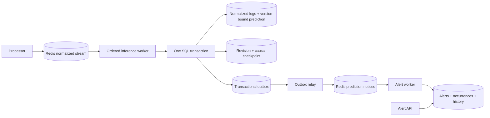

# Phase 6: durable stream processing and alerts

## Implemented flow



Inference acknowledges input only after its prediction, checkpoint, dedup receipt and
outbox record commit together. The relay publishes a small notice containing prediction
and event IDs, not another full log record. Alert management reads the canonical SQL record
and commits alert changes, history and a permanent receipt before acknowledging the notice.
The processor remains unchanged and publishes normalized events as before.

The SQLAlchemy foundation and first frozen Alembic revision arrive in Phase 6 because
ACK-after-commit and an outbox require them. PostgreSQL is the worker default. Explicit
SQLite development mode exercises transactions locally; it is not proof of PostgreSQL
behavior. Phase 7 extends this foundation with the gateway and remaining application data.

## Environment and migrations

On Arch Linux, use the Python environment from [local setup](local-development.md):

```bash
python -m pip install -r services/ml-inference/requirements.txt \
  -r services/alert-manager/requirements.txt
export PYTHONPATH="$PWD:$PWD/services/ml-inference:$PWD/services/alert-manager"
```

The pipeline pins SQLAlchemy 2.1.8, Alembic 1.20.1, redis-py 7.0.1 and Psycopg binary 3.2.13.
The last two packages are not available in this restricted workspace; installation failed.
Real adapters and live test cases exist, but they were not executed here.

Production workers read `POSTGRES_HOST`, `POSTGRES_PORT`, `POSTGRES_DB`, `POSTGRES_USER` and
`POSTGRES_PASSWORD`. Passwords are required and assembled with SQLAlchemy URL objects,
not string-interpolated/logged URLs. Connections use bounded pools, pre-ping, connection,
statement and lock timeouts. Secrets are never printed by the migration helper.

```bash
# PostgreSQL configuration is the default; export your local connection variables first.
python scripts/manage_pipeline.py upgrade
python scripts/manage_pipeline.py current
# Explicit dependency-free database alternative for local transaction development:
export PIPELINE_DB_BACKEND=sqlite
export PIPELINE_SQLITE_PATH=.local/pipeline.sqlite3
python scripts/manage_pipeline.py upgrade
```

The initial revision creates `normalized_logs`, `model_versions`, `predictions`,
`worker_checkpoints`, `processing_receipts`, `outbox_events`, `failed_messages`, `alerts`,
`alert_occurrences` and `audit_events`. Primary/foreign keys, uniqueness, indexes and status
constraints are included. `model_versions` currently records the registry version plus its
effective serving configuration; a development threshold override gets a separate binding.
It is not yet a complete registry mirror. Alert histories share the application audit table.

Workers never automatically create production tables. Alembic owns schema evolution;
`PipelineStore.initialize_development()` is restricted to SQLite test/development use.
Only redacted canonical messages live in `normalized_logs`; predictions/alerts/outbox rows
reference them. Required gateway, provenance/training/source tables and comprehensive data
retention are Phase 7. Do not delete checkpoint/window data or unprocessed outbox records
manually while workers are running.

## Run workers and the alert API

For host workers, a Redis server must be reachable. Export `REDIS_HOST=127.0.0.1`,
`REDIS_PORT` and your `REDIS_PASSWORD`. The base Compose services expose no ports; use the
explicit testing overlay below when connecting from the host. SQLite mode still needs
real Redis for production worker commands—there is no in-memory production broker fallback.

```bash
# Uses the existing approved-model settings and lifecycle ledger:
python -m ml_inference worker
# In another shell with the same database/Redis configuration:
python -m alert_manager worker
# Optional independent relay; the inference loop also relays pending outbox records:
python -m alert_manager relay
```

Each worker supports `--once` for one bounded iteration. Diagnostic statuses contain only
safe reason codes. Model unavailability, database/broker outages and capacity backpressure
retain the input as pending without consuming poison-message retries. An unavailable model
is periodically rechecked. The current default model remains unapproved; this phase did not
change its evaluation or manufacture a successful model/alert demonstration.

The API needs a separate `ALERT_API_TOKEN` (at least 24 random characters). Export the same
value to calling shells; `ADMIN_API_TOKEN` authorizes mutations. Python does not load `.env`
automatically. Tokens should come from local secret configuration; generate independent
values with `openssl rand -hex 24` when configuring a fresh environment.

```bash
python -m alert_manager serve --host 127.0.0.1 --port 8014
```

| Route | Authorization | Behavior |
|---|---|---|
| `GET /health/live` | None | Process liveness |
| `GET /health/ready` | None | SQL store/schema connectivity |
| `GET /api/v1/alerts` | Alert API token | Severity/status filters, pagination and count |
| `GET /api/v1/alerts/{id}` | Alert API token | Alert plus canonical redacted event/prediction |
| `GET /api/v1/alerts/{id}/history` | Alert API token | Creation, recurrence and action history |
| `POST /api/v1/alerts/{id}/acknowledge` | Admin token | Idempotent acknowledgement |
| `POST /api/v1/alerts/{id}/resolve` | Admin token | Idempotent resolution |

```bash
curl --fail-with-body 'http://127.0.0.1:8014/api/v1/alerts?status=open&limit=25' \
  -H "Authorization: Bearer $ALERT_API_TOKEN"
# Replace the quoted value with an alert ID actually returned above:
ALERT_ID='returned-alert-id'
curl --fail-with-body "http://127.0.0.1:8014/api/v1/alerts/$ALERT_ID/acknowledge" \
  -H "Authorization: Bearer $ADMIN_API_TOKEN" -H 'Content-Type: application/json' \
  --data '{"actor":"local-operator","note":"Investigating the recurring pattern"}'
curl --fail-with-body "http://127.0.0.1:8014/api/v1/alerts/$ALERT_ID/resolve" \
  -H "Authorization: Bearer $ADMIN_API_TOKEN" -H 'Content-Type: application/json' \
  --data '{"actor":"local-operator","note":"Recovery confirmed"}'
```

The actor is a local operator assertion protected by the shared admin token, not SSO identity.
Notes are redacted. Resolved alerts cannot be acknowledged again; a new suspicious occurrence
after resolution creates a new alert. Repeated identical actions do not add duplicate history.
API tokens, rate limits and actual body limits run before JSON validation. Errors never echo
untrusted input. Alert actions and their history commit in the same transaction.

## Alert eligibility and grouping

Only an actual `is_anomaly=true` prediction is eligible. ERROR severity alone never creates
an alert. The default requires a warm causal context, so cold-start predictions are recorded
but not alerted. `ALERT_REQUIRE_WARM_CONTEXT=false` explicitly changes that policy.
`ALERT_MIN_SCORE` is an optional raw score floor, not a probability threshold.

Base severity maps INFO→INFO, WARNING→WARNING, ERROR→HIGH and CRITICAL→CRITICAL, only after
eligibility. Configurable score margins above the model threshold can escalate to HIGH or
CRITICAL. Defaults are `ALERT_HIGH_MARGIN=0.15` and `ALERT_CRITICAL_MARGIN=0.30`; margins are
model-specific uncalibrated quantities. Priority is 1 for CRITICAL through 4 for INFO.

Groups use source, service, hostname, redacted template and the effective model/configuration
binding. Recurrences within `ALERT_GROUP_WINDOW_SECONDS` (default 300) increment the count;
severity never decreases. Acknowledged groups remain acknowledged on recurrence. Resolved
groups are closed. Histories record creation policy, recurrences and operator actions.
A changed Drain template can legitimately form a new group; template lineage across evolving
clusters is not inferred here.

## Recovery and delivery semantics

- Consumer groups start at `0-0` to include existing backlog. Each group has one active ordered
  handler protected by a Redis lease. Standbys recover the oldest pending message with XCLAIM
  only after its idle threshold. Later entries do not bypass an older pending entry.
- `CONSUMER_LEASE_MS` defaults to 30000 and `CONSUMER_CLAIM_IDLE_MS` to 60000; claim idle must
  not be smaller than lease duration. Database checkpoint revision comparison also rejects
  stale inference commits; uniqueness and transactions prevent duplicate business changes.
- Durable receipts use canonical event IDs. A changed event under an existing ID is rejected;
  retrying an already committed input skips scoring even after process restart/model changes.
  New-model re-scoring of historical events must be an explicit future workflow, not replay
  of the live input stream.
- Recovery rebuilds causal counters from committed records within the model window and keeps
  the original observation start time. Checkpoints contain references/time metadata, not a
  second full copy of log messages. A new model window can query the required preceding SQL
  history. The real-model test reproduces scores after a crash between commit and ACK.
- Outbox relays claim rows with leases (`FOR UPDATE SKIP LOCKED` on PostgreSQL), publish, then
  mark them sent. Publish-before-mark crashes can repeat the notice; broker dedup and permanent
  alert receipts make this safe. SQL/Redis are not claimed to form one distributed transaction.
- Data/logic failures retry with exponential backoff up to `CONSUMER_MAX_RETRIES` (default 5).
  Model absence, outages and capacity exhaustion do not spend that budget. Malformed/conflicting
  records are quarantined immediately. Failure metadata commits before dead-letter plus ACK.
- Dead letters contain stream/group/entry IDs, a safe reason, attempt count and SQL failure ID;
  they never echo a malformed payload. Valid redacted rejected records can be retained in the
  canonical table; conflicting IDs never replace the original. Authentication payloads are
  not persisted. A full dead-letter stream blocks acknowledgement until capacity is restored.
- Source/prediction trimming is atomic and bounded by every current group's oldest pending
  ID or delivered watermark. Unread groups prevent deletion. Nothing is trimmed when no
  group exists. One last delivered entry is conservatively retained, so the pipeline requires
  `STREAM_MAX_LENGTH` of at least 2. No approximate trim
  can remove unread/pending messages. Adding a new group after trimming requires replay from
  durable SQL history; manual cursor resets/stream deletion while processing are unsupported.
- This implementation targets standalone Redis 7.4, not Redis Cluster. Redis AOF settings and
  persistent volumes remain in the base Compose file. Claims are at-least-once delivery with
  idempotent business transactions, not globally exactly-once transport or lossless hardware.

Live inputs must preserve nondecreasing event timestamps for the shared causal feature
contract. Late events are quarantined with `out_of_order_event` rather than silently scored
with future context. Multi-host production collection may require an event-time reorder
buffer; it is not implemented here. A quarantine is a visible failed event, not a successful
prediction. Review/replay after correcting the input policy is an operator workflow.

## Configuration and resource boundaries

Additional settings are in `.env.example`: stream/group names, capacity, dedup TTL, lease,
retry/backoff, outbox capacity, PostgreSQL host and alert policy. Defaults preserve existing
stream names. The SQL outbox stops intake at 10000 pending rows by default. Redis publication
also refuses capacity overflow; backpressure propagates without discarding unprocessed logs.

API replicas and worker replicas are separate processes. HTTP exploratory inference contexts
never share the ordered consumer's context. One handler owns the global live feature stream;
this is a deliberate local throughput constraint, not arbitrary horizontal scaling. Group
scaling requires a partition-aware feature/training design. Mutable contexts/checkpoint
revision are rebuilt from durable data. Worker heartbeats contain status/reason/timestamps,
not payloads; container checks use them. Full application metrics/dashboards remain Phase 10.

Database uniqueness/dedup records currently persist; comprehensive retention/archival is
Phase 7. Removing receipts or canonical history blindly breaks replay guarantees. SQLite
serializes test writes with BEGIN IMMEDIATE; PostgreSQL uses row/advisory locks. PostgreSQL
concurrency behavior has not been validated in this restricted environment.

## Compose setup

With required secrets filled in `.env`:

```bash
docker compose -f docker-compose.yml -f compose.mlflow.yml -f compose.ingestion.yml \
  -f compose.inference.yml -f compose.streams.yml config --quiet
docker compose -f docker-compose.yml -f compose.mlflow.yml -f compose.ingestion.yml \
  -f compose.inference.yml -f compose.streams.yml up --build -d
```

`pipeline-init` runs Alembic once before workers/API start. Additional processes are
`inference-worker`, `outbox-relay`, `alert-worker` and `alert-manager`. Application containers
run non-root, use resource limits/internal networking, and publish API ports only on localhost.
The inference worker reads the existing lifecycle audit volume, which must be populated by
approved registration through `compose.lifecycle.yml`. It does not wait for inference HTTP
readiness, so an unapproved model leaves work recoverable instead of stopping the worker.
Docker health becomes unready while model/dependencies are unavailable; the worker remains
running and retries. Images and live services could not be started here.

For host integration tests, explicitly publish Redis/PostgreSQL locally:

```bash
docker compose -f docker-compose.yml -f compose.testing.yml up -d
# Export REDIS_PASSWORD/POSTGRES_PASSWORD from your secret configuration first.
export REDIS_HOST=127.0.0.1
export POSTGRES_HOST=127.0.0.1
export RUN_REDIS_INTEGRATION=1
export RUN_POSTGRES_INTEGRATION=1
python -m unittest discover -s tests/integration -p 'test_*.py' -v
```

Use a disposable PostgreSQL test database. Its live test creates/drops only its own randomly
named schema. The Redis live tests create and remove only uniquely namespaced test keys;
they never FLUSHDB. Driver dependencies and a normal host with socket access are required.

## Executed checks and limits

See [Phase 6 validation](phase6-validation.md). Local tests use real SQLAlchemy/SQLite and
real trained/registered models where stated, plus an explicitly test-only memory broker
for failure injection. This does not prove real Redis behavior. Live Redis/PostgreSQL test
cases are included and skip visibly without required opt-in/services. Lua syntax/watermark
checks on the local Lua interpreter do not establish Redis command or embedded-Lua runtime
compatibility. Compilation and Compose rendering are not container health evidence.

Relevant command semantics follow the official Redis [XREADGROUP](https://redis.io/docs/latest/commands/xreadgroup/),
[XPENDING](https://redis.io/docs/latest/commands/xpending/),
[XCLAIM](https://redis.io/docs/latest/commands/xclaim/) and
[XACK](https://redis.io/docs/latest/commands/xack/) documentation.
